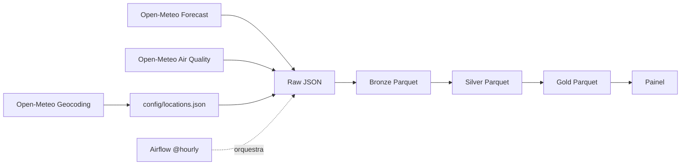

# Radar Ambiental

Pipeline de engenharia de dados que coleta, de hora em hora, a **previsão do tempo** e a **qualidade do ar** das 27 capitais brasileiras, organiza os dados em camadas (raw, bronze, silver e gold) e os entrega prontos para um painel de acompanhamento.

> Projeto de portfólio. Os dados são de previsão (modelos numéricos), não de estações de medição.

## Objetivo

Responder, para cada capital:
- Como estão o clima e o ar agora, e como ficam nas próximas horas?
- Quais capitais têm pior qualidade do ar, e isso coincide com falta de chuva?
- Como cada capital se compara dia a dia (temperatura, chuva, umidade e poluentes)?

## Arquitetura

| Camada | Pasta | Conteúdo |
|---|---|---|
| Raw | `data/raw/` | Resposta das APIs sem alteração, com `uf` e `name` acrescentados a cada registro |
| Bronze | `data/bronze/` | Raw achatado: uma linha por capital e hora, em Parquet, sem tratamento de tipos |
| Silver | `data/silver/` | Uma tabela por fonte, com tipos corretos (`time` em UTC), sem unidades nem metadados da grade |
| Gold | `data/gold/` | Tabelas integradas e agregadas para consumo (ver abaixo) |

## Fontes de dados
Dados fornecidos pela [Open-Meteo](https://open-meteo.com), de uso gratuito para fins não comerciais e com atribuição, conforme os termos da API.

| Fonte | Endpoint | Variáveis horárias |
|---|---|---|
| Previsão do tempo | `api.open-meteo.com/v1/forecast` | `temperature_2m`, `precipitation`, `precipitation_probability`, `relative_humidity_2m` |
| Qualidade do ar | `air-quality-api.open-meteo.com/v1/air-quality` | `pm10`, `pm2_5`, `ozone` |
| Geocodificação | `geocoding-api.open-meteo.com/v1/search` | usada uma única vez para gerar `config/locations.json` |
